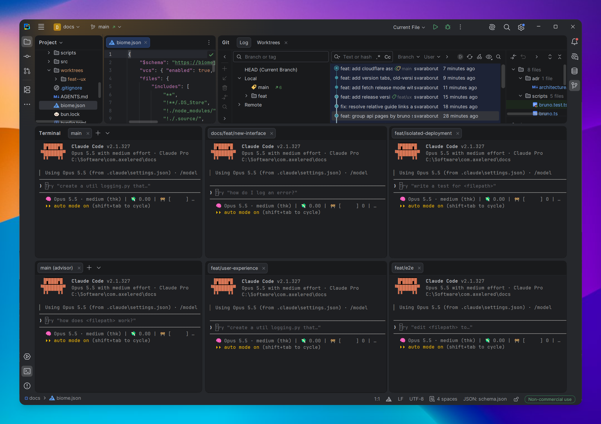

<div align="center">

# Work3 CLI

**Run a fleet of Claude Code agents in parallel, each on its own branch, in its own fully set up worktree.**

[](https://github.com/svaraborut/work3/stargazers)
[](https://bun.sh)
[](https://www.typescriptlang.org)
[](https://claude.com/claude-code)
[](https://www.npmjs.com/package/work3)
[](LICENSE)



<sub>Six agents, six branches, zero collisions. One `work3 open` each.</sub>

</div>

Your one-stop solution to manage worktrees in your agentic projects. Two agents in the same checkout overwrite each other's files. Plain `git worktree` fixes that, then leaves you reinstalling dependencies, copying `.env` files, inventing folder names and cleaning up stale trees by hand, for every branch, every day. work3 turns all of it into one command, configured once per repository and shared with your whole team.

**The old way**

```shell
git worktree add -b feat/login worktrees/feat--login main
cd worktrees/feat--login
bun ci
cp ../../.env .env
claude --remote-control my-app/feat/login
```

**🚀 With work3**

```shell
work3 open feat/login
```

## Why work3

- 🚀 **One command per branch** - `work3 open <branch>` creates the worktree, runs your setup and drops you into Claude Code, or reopens it if it already exists.
- 📦 **Setup that lives in the repo** - `initialize` and `destroy` tasks in `worktree.json` install dependencies, copy secrets and clean up, the same for everyone on the team.
- 📱 **Steer every agent from your phone** - each session starts with Claude Code Remote Control, named `<repo>/<branch>` so parallel sessions stay distinguishable.
- 🖥️ **Cross-platform tasks** - commands run through Bun Shell, so `cp $WORK3_ROOT/.env .env` works on Windows, macOS and Linux alike.
- 🛡️ **Safe teardown** - `work3 rm` refuses to delete uncommitted work and never runs destroy tasks on a worktree it will not remove.
- 🧭 **No hidden state** - git is the only source of truth, and every command works from the main checkout or from inside any worktree.

## Install

Requires [Bun](https://bun.sh) 1.2.21 or newer, git, and [Claude Code](https://claude.com/claude-code) on your `PATH` (unless you always pass `--no-claude`).

```shell
bun add -g work3
work3 --help
```

Or run it without installing: `bunx work3 open feat/login`.

## Quick start

```shell
cd my-project
work3 init               # writes worktree.json and ignores /worktrees/
work3 open feat/login    # create, set up and start claude
work3 ls                 # see all worktrees and their status
work3 fold feat/login -rd  # fast-forward main, remove worktree and branch
work3 rm feat/login -d   # or discard: run destroy tasks, remove worktree and branch
```

## Commands

### `work3 init [--yaml]`

Creates the config in the root of the current repository.

- Writes `worktree.json`, or `worktree.yaml` with `--yaml`.
- Sets `base` to `main` if that branch exists, otherwise to the current branch.
- Adds `/worktrees/` to `.gitignore` unless it is already ignored.
- Refuses to run if a config file already exists.

### `work3 open <branch> [--from <ref>] [--no-claude]`

Alias: `create`. Creates the worktree if needed, then starts `claude --remote-control <repo>/<branch>` inside it.

| Situation | Behaviour |
|---|---|
| Worktree already exists | Reopened as is, `initialize` tasks are not run again |
| Branch exists, no worktree | Branch is checked out in a new worktree, `--from` is ignored |
| Branch does not exist | Branch is created from `--from`, or from `base` in the config |

| Flag | Description |
|---|---|
| `--from <ref>` | Base ref for a new branch, overrides `base` (for example `origin/main`) |
| `--no-claude` | Skip launching Claude and print the worktree path instead |

If an `initialize` task fails, work3 stops, keeps the worktree for inspection and does not start Claude.

### `work3 list`

Alias: `ls`. Lists worktrees under `location` with their branch, status and path.

- `clean` - no changes.
- `dirty` - uncommitted or untracked files.
- `missing` - registered in git but the folder is gone.

### `work3 remove <branch> [-f] [-d]`

Alias: `rm`. Runs `destroy` tasks, then removes the worktree.

| Flag | Description |
|---|---|
| `-f, --force` | Remove even with uncommitted or untracked changes, continue past failing destroy tasks, force-delete the branch |
| `-d, --delete-branch` | Also delete the branch (kept by default) |

work3 refuses to remove the worktree you are currently in, and refuses dirty worktrees before any destroy task runs.

### `work3 fold <branch> [--into <ref>] [-r] [-f] [-d]`

Lands a finished branch on `base` by fast-forward only: no merge commits, no rebases, no pushes.

- Refuses if the worktree has uncommitted or untracked changes, so no work is left behind.
- Refuses if the branch is not a fast-forward of the target, and tells you to rebase it inside the worktree.
- If the target is checked out (usually in the main checkout), its files are updated too.

| Flag | Description |
|---|---|
| `--into <ref>` | Target branch, overrides `base` |
| `-r, --remove` | Remove the worktree after folding, same as `work3 remove` |
| `-f, --force` | With `-r`: continue past failing destroy tasks |
| `-d, --delete-branch` | With `-r`: also delete the folded branch |

If removal fails after a successful fold, the fold is kept and `work3 rm <branch>` retries the cleanup.

## Configuration

work3 reads its config from the root of the main checkout, looking for `worktree.json`, `worktree.yaml` or `worktree.yml`. If more than one exists, work3 warns and uses the first. Commit the config so the whole team shares the same augmented workflow.

```json
{
  "location": "worktrees",
  "base": "main",
  "initialize": [
    { "name": "install", "cmd": "bun ci" },
    { "name": "env", "cmd": "cp $WORK3_ROOT/.env .env" }
  ],
  "destroy": [
    { "name": "cleanup", "cmd": "echo removing $WORK3_BRANCH" }
  ]
}
```

| Key | Type | Default | Description |
|---|---|---|---|
| `location` | string | `"worktrees"` | Folder for worktrees, relative to the repository root |
| `base` | string | `"main"` | Ref new branches start from, overridable with `--from` |
| `initialize` | task[] | `[]` | Tasks run once, right after a worktree is created |
| `destroy` | task[] | `[]` | Tasks run before a worktree is removed |

Each task is `{ "name"?: string, "cmd": string }`. `name` is shown in the output, `cmd` is shown when `name` is missing.

### Tasks

Tasks run one after another, inside the worktree folder, through [Bun Shell](https://bun.sh/docs/runtime/shell). Built-ins such as `cp`, `rm`, `mkdir` and `echo` behave the same on every OS. These environment variables are available in addition to your own:

| Variable | Value |
|---|---|
| `WORK3_ROOT` | Path of the main checkout |
| `WORK3_PATH` | Path of the worktree |
| `WORK3_BRANCH` | Branch name |

### Folder names

Worktree folders are named after the branch with `/` and `\` replaced by `--`, so `feat/login` lives in `worktrees/feat--login`.

## Good to know

- work3 never fetches. `base: "main"` means your local `main`, use `--from origin/main` for the remote one.
- Tools in the main checkout (tsc, eslint, test runners, IDE indexers) may scan `worktrees/`. Exclude it in their configs if they do, or move `location` outside the repository, for example `"../my-project.worktrees"`.

## Development

```shell
git clone https://github.com/svaraborut/work3.git && cd work3
bun install
bun run build && bun link   # puts your local build on PATH as work3
bun run dev -- --help       # run from source without building
bun test
bun run typecheck
```

## Todo

- Spawn new agents from Claude
- Make it harness agnostic

## License

[MIT](LICENSE) © Borut Svara
